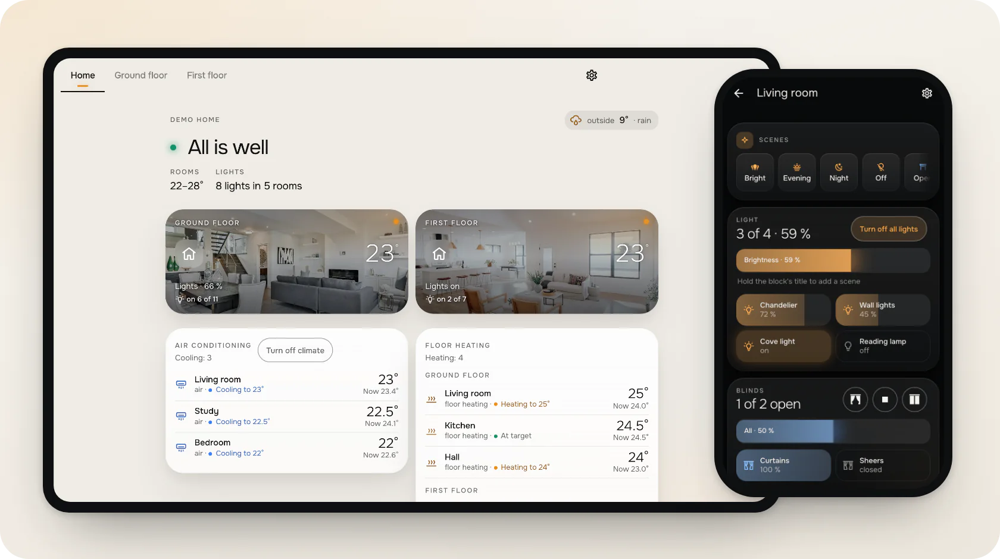

# Hauflo agent

**English** · [Русский](https://github.com/Hauflo/hauflo-agent/blob/main/README.ru.md)

The Hauflo agent connects a site's Home Assistant to the Hauflo service: deploys from the project, the dashboard and alarms.

Free during the beta; needs a Hauflo account ([request access](https://app.hauflo.com/request-access)).

  

**Install:** Settings → **Marketplace** → **Add from link** → `https://github.com/Hauflo/hauflo-agent` (Integration); on Home Assistant before 2026.11 — HACS → ⋮ → **Custom repositories**. [Full steps](#install).

## Install

**You need** Home Assistant 2026.9 or newer, a GitHub account for the [Marketplace](https://www.home-assistant.io/integrations/marketplace/) (built in since Home Assistant 2026.11; [HACS](https://hacs.xyz) on older versions), outbound HTTPS, and a KNX IP interface or router that Home Assistant’s KNX integration supports.

1. **Add the repository.** Use the button (it opens the Marketplace, or HACS on older Home Assistant), or by hand:

   **Home Assistant 2026.11 and newer:** **Settings → Marketplace**. On the first visit tick **I understand the risks and agree** → **Continue**. Then **Add from link**, paste `https://github.com/Hauflo/hauflo-agent`, type **Integration**. Home Assistant asks to **Connect GitHub**: **Continue**, open the link and enter the code shown. Hauflo is not in the Marketplace catalog yet, so adding it by link needs this connection; it reads public data only.

   **Before 2026.11:** in HACS open ⋮ → **Custom repositories**, paste `https://github.com/Hauflo/hauflo-agent` and choose **Integration**.

   

2. Open **Hauflo** → **Install** (in HACS — **Download**) and **restart Home Assistant**.

   **GitHub doesn't open** (happens in some regions): in the Home Assistant terminal (Terminal & SSH add-on) run
   `wget -qO- https://app.hauflo.com/agent/install.sh | sh` and restart Home Assistant. The script takes the same
   release archive from the first source that answers — GitHub, app.hauflo.ru, app.hauflo.com — and checks its
   checksum against Hauflo's servers. Updating is the same run.
3. **Get a connection code** in Hauflo: your project → **Connect the site** → **Get a code**. It works once, for 30 minutes.
4. **Add the integration** and enter the code. The code picks the server: `EU-…` → app.hauflo.com, `RU-…` → app.hauflo.ru. **Advanced → Hauflo server** is only for a server of your own; leave it as is. If this Home Assistant is still connected to a site of another Hauflo account, a checkbox **Yes, move this Home Assistant to this project** appears. Without it nothing changes.

   

   The link works only after Home Assistant has been restarted with Hauflo installed, and only if “My Home Assistant” knows your instance address (Settings → My Home Assistant). If it shows “unknown integration” or does not open, go by hand: Settings → Devices & services → **Add integration** → **Hauflo**.

5. **Confirm the KNX addresses.** Remove any Hauflo must not control, such as a gate or a lock.
6. Hauflo shows **agent online** in a few seconds. Open **Deploy**, check the plan, deploy.

## Options

**Settings → Devices & services → Hauflo → Configure.** Saved at once, no restart.

- **Allow Hauflo to change this site's setup** (on by default). Off: Hauflo changes nothing in Home Assistant. Deploys, dashboards, rooms, KNX entities and backups started by Hauflo are refused. Monitoring, alarms and voice keep working.
- **Allowed addresses.** The KNX group addresses Hauflo may send commands to: `1/1/5`, a span `1/1/1-21` or a whole middle group `1/1`, comma-separated or one per line. Remove any Hauflo must not control, such as a gate or a lock.
- **Allow these requested addresses.** Shown only when Hauflo asked for addresses outside the list (Repairs says so too). Unticked ones are declined when you save.
- **Make the site independent of Hauflo.** A tick that opens its own step: what it does, what stops, then your confirm. See [Leaving Hauflo](#leaving-hauflo).

Reconnect with a new code (another project): **⋮ → Reconfigure**. Disconnected in Hauflo: Home Assistant asks for a new code itself (**Re-authenticate**).

## Entities the integration creates

All of them belong to one service device, **Hauflo**.

| Entity | What it is | When |
| --- | --- | --- |
| `binary_sensor.hauflo_connection` (**Connection**, diagnostic) | On while the agent is connected to Hauflo. Attribute `server`: which Hauflo server. | Always |
| `sensor.hauflo_made_at_this_site` (**Made at this site**, diagnostic) | How many entities Hauflo made or took over here. Attributes: `by_kind`, `hand_edited` (renamed or disabled in Home Assistant, or kept as a hand edit by the last plan), `next_deploy` (what the next deploy would create, update, offer to remove, and when Hauflo said it). Read only. | Always |
| `sensor.hauflo_house_state` (**Site status**) | All good / Fault / Alarm / Devices offline — the same level the cards and Hauflo's monitoring show. Attributes: the counts by level, the active signals, since when. For the client's own automations. | Always |
| `binary_sensor.hauflo_house_problem` (**Site problem**) | On while the site status is anything but All good. | Always |
| `sensor.hauflo_panel` (**Panel**, diagnostic) | What the cloud last said of this site's Hauflo dashboard: Up to date / Refreshed / Waiting to be applied / Agent update needed. | Always |
| `binary_sensor.hauflo_daylight` (**Daylight outside**) | On while it is light outside: by an outdoor lux sensor an administrator chose, otherwise by the sun’s elevation; a change holds 10 minutes. While it is on, a Hauflo scene leaves off the lights the client marked **Leave off in scenes by day** (a niche, a shelf). Attributes: `source`, `value`, `threshold`, `since`. | Always |
| **Recommended season** / **Current season** (sensors), **Switch automatically** (switch) | Winter / Summer (or Heating / Cooling): the mode in force, what the outdoor temperature suggests, and whether the mode is switched once a day by itself. The switch can be changed only by staff, not by the client. | After Winter / Summer is set up in Hauflo |
| **Rule · name** (switch), **Rule active · name** (binary sensor) | One on / off switch and one “has fired” sensor for each rule (by a value, for example ventilation by CO₂, or by a schedule). | After a deploy with rules |

**The label “Hauflo”.** Every entity Hauflo made or took over carries the label **Hauflo** (**Settings → Areas, labels & zones → Labels**, or the label filter on the entities page). The agent puts it on and takes it off itself, only on Hauflo’s own; a label set by hand on anything else is taken off. Entity ids never change. While **Allow Hauflo to change this site's setup** is off, the label isn’t touched. **Hauflo monitoring** is a different label: you put it on devices Hauflo didn’t make, to watch them.

Everything else a deploy makes (rooms, KNX entities, light groups, scenes, dashboards) belongs to Home Assistant's own integrations, not to this one.

## Actions

**Developer tools → Actions**, or in your automations and scripts. They exist from Home Assistant's start; while the integration isn't loaded (turned off, still starting) each one stops with “Hauflo isn't loaded yet”. Errors are shown in your Home Assistant language.

| Action | What it does | Fields |
| --- | --- | --- |
| `hauflo.lock` | Locks, unlocks or opens a door, as the lock buttons on the dashboard do: locking is open to anyone, unlocking and opening only to the people chosen in the lock's settings (none chosen: everyone). | `entity_id` (a lock), `action`: `lock` / `unlock` / `open` |
| `hauflo.off_in` | Turns a light off in N minutes; `0` cancels. Kept until Home Assistant restarts. | `entity_id` (a light), `minutes` (0–1440) |
| `hauflo.unprotect` | Administrators only; the Hauflo cloud can't call it. Takes the gate protection off KNX entities or group addresses Hauflo once saw as a gate, garage door or door. An entity whose class is still a gate is protected again at once. If something isn't found, nothing changes and the error says what. | `entity_id` (KNX entities) and / or `group_address` (`1/2/3`) |
| `hauflo.remove_alarms` | Administrators only; the Hauflo cloud can't call it. Removes Hauflo's alarm automations “Alarm: …” and their “Hauflo · accepted: …” helpers, hand-edited ones too; the agent sends the alarms itself until the next deploy. | — |
| `hauflo.intercom_answer` | Answers a door call: the one who answered talks, the others see “Answered on another device”. | `entity_id` (the door's intercom entity) |
| `hauflo.intercom_hangup` | Declines a call or ends the talk. Only an administrator can end someone else's conversation. | `entity_id` (the door's intercom entity) |

## How data updates

No polling. The agent keeps one outgoing WebSocket to Hauflo, reconnecting by itself with backoff. **Connection** changes the moment the connection does. Every minute the agent sends Hauflo a short status (see [What leaves the house](#what-leaves-the-house)).

## What leaves the house

Hauflo can ask only for what is on the agent's fixed list, and the agent edits some answers before they leave. Exactly:

**During a deploy, a devices check and monitoring:**

- **The states of entities of any integration, not only KNX:** entity id, state, name and a fixed set of attributes (device class, unit, temperatures and setpoints, modes, brightness and color temperature, positions, options, min / max / step). Every other attribute stays home.
- **Left out entirely:** the phones' entities (every `mobile_app` entity) — not even their entity ids, which carry the phone's name.
- **Scrubbed:** people, device trackers, zones, cameras, images, media players, calendars, to-do lists, weather, the sun, locks, alarm panels, notify / TTS / STT / conversation, and motion, occupancy, presence, door, window and garage door sensors (unless Hauflo made them or you gave them the **Hauflo monitoring** label). Of these only the name, device class, icon and supported features leave. The state reads `hidden`, the times are removed.
- **The entity registry list** (entity ids, names, integrations, unique ids, rooms, labels; without the phones' entities) and **the device registry list** (names, models, makers, rooms; for phones the name, model and maker are removed).
- **For the alarm settings** (who gets alarms): the people of this Home Assistant and the phones with the Home Assistant app — their names, OS and owner — so you can pick recipients in Hauflo.
- Rooms, floors and labels. The titles of all dashboards and the content of Hauflo's own dashboards (never the client's other dashboards). Which entities are exposed to voice assistants.
- Home Assistant's version, time zone, language, unit system, currency, the list of loaded integrations and the external URL without a login. Whether Home Assistant Cloud is on, with Alexa and Google, without the account. Not the home's coordinates or name.
- KNX: the ETS project loaded in Home Assistant's KNX integration, the settings of KNX entities, and which group addresses sent telegrams (addresses and times, never values).
- The HomeKit bridge Hauflo set up: its pairing code and QR, shown to you in Hauflo to add the bridge to Apple Home (not stored). Alice: its label settings.

**Every minute:** Home Assistant and agent versions, the KNX connection, how many KNX entities are unavailable (up to 10 ids), the name and state of entities labelled **Hauflo monitoring**, open alarms, and whether the owner's switch is off. **Home Assistant health:** when the last backup was made, free and total disk space, which Home Assistant updates are waiting (core, OS, supervisor: installed and available version), and until when the certificate of the external address is valid (not the address's contents; never backup contents). Hauflo tells the site's people when the last backup is too old, the disk is nearly full, a system update waits or the certificate is about to end. The limits are in `tuning.json`. For the service passport in the handover pack: how KNX is connected (tunnel or routing, the gateway's address and port, the individual address; whether KNX Secure is on — never its keys or passwords), Home Assistant's address and the names of its administrators (no passwords).

**On request** (still the fixed list, still over the one outgoing connection): commissioning checks after a deploy (the bus, scenes, groups, automations, the dashboard, voice) read only states and the registry; “read after a command” and polling for devices without feedback; **What voice assistants can reach** and **Close the dangerous** change only which entities are exposed to voice; “+ Own signal” turns any entity of the site into an alarm signal; the fleet updates the agent in waves, with a way back to the previous version (the agent installs only a release signed by Hauflo's offline key: a substituted file is refused, nothing changes).

**Every minute, also:**

- **The one alarm count:** the alarms open now with their sensor name, class and since when, counted once by the agent — Hauflo's monitoring, the cards, the fleet and the Telegram bot show this number.
- **Observations on the site's own norm** (the “Background observations” and “Habits” of **Analysis**): a zone or sensor clearly off its learned norm — entity name, the finding and its numbers, never an action — and your **This is normal** / **Watch again** choices made on the card in Home Assistant.
- **Other integrations the agent watches:** which ones it restarted, could not bring back or saw come back.
- **Alarm signals:** the **Alarm when** choices made on a card's row in Home Assistant and the hash of the signal policy the agent holds.
- **The integrations Hauflo is installing here,** with the steps of each; the time zone, whether the owner's switch is off, which features this agent version has, and whether its alarm rules are known yet.

**Guest access:** while a guest uses a link, the states of the lights, blinds and climates of the rooms in that link pass through Hauflo to the guest's browser, and the guest's IP address reaches the Hauflo server like any visitor's. Who the guest is is not recorded; the guest log stays in Home Assistant.

**Never:** where people are, camera images or tokens, media, calendars, PIN codes (other than the HomeKit pairing code above), passwords, KNX Secure keys, backups, the history database.

**Where data is stored.** EU accounts at app.hauflo.com, in the EU. Russian accounts at app.hauflo.ru, in Russia. One exception in transit: the Russian region has no direct access to Telegram, so the text of a Telegram alert and the recipient's chat ID pass through a Hauflo relay server in Germany on the way to Telegram (not stored, not logged). The EU region sends them to Telegram directly.

## Security in plain words

- **One outgoing encrypted connection.** Nothing listens on the home network. Hauflo keeps no Home Assistant token: the agent is its own system user, removed together with the integration.
- **A fixed list of what Hauflo may do,** checked inside this Home Assistant. KNX commands go only to the addresses you confirmed.
- **The owner’s switch.** In the integration’s options: **Allow Hauflo to change this site’s setup**. Off, and Hauflo changes nothing. Monitoring, alarms and voice keep working.
- **A backup before changes.** Deploying without one is only an explicit choice, and then a notice stays in Home Assistant. Restore it from **Settings → System → Backups**, with or without Hauflo.
- **Open to read.** The source code is here, so you can check what runs in the home.

<b>The full list: may and may not</b>

**Hauflo may, through the agent:**

- create rooms, floors and labels, and the KNX devices of the project;
- create and update its own dashboards and scenes, set its dashboard and theme as the default;
- write its own rules (`hauflo_auto_*`) into `automations.yaml`, never touching other automations and never rewriting a hand-formatted file;
- set the home's location and time zone in Home Assistant: only an administrator, from the dashboard's **Settings → Automations** page;
- hide Home Assistant's extra sidebar panels (Map, Energy, Logbook…) for everyday users (everyone but Home Assistant administrators — they keep the full menu unless **Administrators too** is on), with the **Clean up the menu** option;
- copy its card files to `/config/www/hauflo`;
- set up the KNX connection to an interface in the house, light groups, voice exposure and the Apple Home bridge;
- set the room, the name and the dashboard block (a `hauflo_role_*` label) of another integration’s devices and entities, only as the integrator chose in **Check › Devices** and only in a deploy plan. What opens the house (locks, alarm panels, valves, gates, garage doors), the KNX bus and phones are never moved to a room or given a block. Every first value is kept, and **Revert** restores it (what you changed yourself afterwards stays);
- read states for monitoring and alarms;
- send KNX commands only to the group address ranges you confirmed.

**It may not:**

- download backups, or touch add-ons, other automations or arbitrary services;
- delete devices and entities it didn’t create, or change them beyond the room, name and block above (your hand-made ones stay yours);
- read KNX Secure keys or passwords;
- give a lock, an alarm panel or a valve to a voice assistant, a group or a scene.

**The backup** holds the settings without the history database. It is encrypted if your Home Assistant has a backup key. Without a fresh one, the agent changes nothing, unless the integrator explicitly chooses to deploy without it; then a notice stays in Home Assistant.

**What leaves the house** is listed exactly in [its own section](#what-leaves-the-house).

<b>Alarms</b>

Set up in Hauflo → **Alarms**. A rule is: what happened → which sensors → who gets it → how.

- **Push to the client’s phones** through the Home Assistant app. Critical alarms ring even in silent mode (iOS Critical Alerts, the Android alarm stream). They repeat until someone taps **Accept** (the first 12 times at the rule’s pace, then hourly, so a night of repeats never uses up the phone’s daily push limit); “back to normal” clears the notification. An action button does the obvious thing, such as “Shut off water”.
- **Telegram** through [@hauflo_bot](https://t.me/hauflo_bot), for you, the engineer on duty or the client. Each person gets only the alarms of their own sites.
- Every rule is an automation in this Home Assistant with an **Accept** switch, named “Alarm: <rule>” (its id in `automations.yaml` is `hauflo_alarm_…`; the entity id Home Assistant gives it comes from the name, e.g. `automation.avariia_…`, and is never renamed). It runs without Hauflo and without the agent, also when the internet is down, and stays after the integration is removed. A rule Home Assistant can't hold (a hand-formatted `automations.yaml`, changes closed by the owner) stays with the agent, and you're told so. An automation you edited by hand is never overwritten.
- The automation is small enough to read in the visual editor: three triggers (in alarm for the rule’s hold, every sensor back in normal, **Accept** from the push) and two actions (the push / “back to normal” / “Accepted”, then the repeat while the alarm is open: the first 12 times at the rule’s pace, then hourly). A second helper “Hauflo · alarm open: …” (`input_boolean.hauflo_open_…`) remembers the open alarm. A chattering sensor and “no data” are told by the agent: Home Assistant tells every alarm that held after the sensor was back in normal longer than the rule’s window; the repeat and the button wait in the automation’s run, so a restart of Home Assistant ends them (the next alarm starts them again).
- **Importance of signals** (by ISA-18.2, the **Importance** block on the Alarms page; the site's integrator and the company's owner / admin change it): leak, smoke, gas, CO, KNX and lost connection — at once; other rules and events — important (a repeat at most once an hour); short connection drops and hints go to the digest. “Off” turns a class off.
- **Daily digest** at 08:00 site time, one message of up to 12 items, to personal Telegram chats and groups. **Quiet hours** 23:00–08:00 hold “important” messages for the digest; critical alarms always arrive at once. A sensor that fired 3 times in a day goes to the digest for a day.
- **A Telegram group:** add the bot to a group yourself — if your private chat with the bot is already connected, the group joins the account at once (the link in the app still works); forum topics work as before.
- Alarms go by push and Telegram only; email is not an alarm channel.

To watch any other entity (a boiler fault, ventilation, a battery), give it the label **Hauflo monitoring** in Home Assistant.

<b>Voice</b>

- **Assist sentences for floor heating and thermostats.** A KNX floor heating often has no on/off object, so Home Assistant answers “turn off the floor heating” with an error. The agent adds its own sentences: it switches off where the thermostat can, and otherwise explains that it holds the setpoint. Setting or asking a room’s temperature goes to that room’s thermostat.
- **Apple Home and Yandex Alice.** A deploy can set up an Apple Home bridge (with a pairing QR code on the handover page) and expose rooms to Alice. Locks, alarm panels and valves are never exposed.

<b>Does the agent send commands to the KNX bus by itself?</b>

No. A command goes to the bus when a person acts: a tap on the dashboard, a scene, voice, an alarm’s action button, the Winter/Summer switch, or a rule the client set in **Automations**.

Two exceptions. The first: the **Winter/Summer resend**. A KNX thermostat can lose its mode after a bus power loss or a reset, so the agent sends the mode the client chose again — every hour by default (the integrator can change it or turn it off), after Home Assistant starts and when the KNX connection is back. It never turns a thermostat on; a shared heat/cool address goes once. The outdoor-temperature suggestion only asks the client, it never switches by itself.

The second, when the client switches it on: **Away — presence simulation**. Lights only in the evening dark, blinds at the usual times; only Hauflo’s own lights and blinds. Switched off, it turns off the lights it turned on.

<b>What happens if Hauflo or the internet is down?</b>

The home keeps working. It is plain Home Assistant with standard KNX devices. The dashboard, automations, push alarms and the Winter/Summer switch run inside Home Assistant. Hauflo shows the site as offline, and the agent reconnects by itself.

<b>Will Hauflo overwrite what I made by hand?</b>

No. Hauflo keeps a list of what it created and changes only that. The one exception is another integration’s devices that the integrator set up in **Check › Devices** (room, name, block), and **Revert** undoes it. Your own entities, automations and dashboards stay as they are. If you edited something Hauflo made, it notices and keeps your edit.

<b>How do I allow more KNX addresses later?</b>

**Settings → Devices & services → Hauflo → Configure.** If Hauflo needs an address that isn’t allowed yet, it waits there for you to confirm.

<b>“The code is wrong or expired”</b>

A code works once, for 30 minutes. Get a new one in Hauflo: your project → **Connect the site** → **Get a code**. If Home Assistant can’t reach Hauflo at all, check its internet access.

<b>“I press in HA — the actuator is silent”</b>

Open the group monitor (**Settings → Devices & services → KNX → Monitor**) and press again. No telegram: the address is outside the agent’s allowed ranges (**Settings → Devices & services → Hauflo → Configure**) or the tunnel is busy (ETS, a visualisation). Telegram goes out but the actuator ignores it: the actuator’s object in ETS needs the **W** flag (and **T** for status) and the device must be programmed.

<b>“My Home Assistant is older than 2026.9”</b>

**Settings → About** shows the version; update in **Settings → System → Updates** (take a backup first). The agent needs 2026.9 or newer.

<b>How the agent updates itself</b>

The integrator starts an update of the agent from the Hauflo cloud; nothing is installed without their confirmation. The agent downloads the published release from GitHub, checks its sha256 and the release's Ed25519 signature (`hauflo.zip.sig`, public keys in the code), swaps the files and waits for the restart the integrator confirmed — a restart is never automatic. If the new code fails to load, the previous version is restored. **Settings → System → Updates** keeps working as before; the Hauflo update is the same release that is published there. The font Onest in `www/fonts` is under the SIL Open Font License 1.1 (`www/fonts/OFL.txt`).

<b>“What changes in the panel when the agent updates?”</b>

After the update (Settings → Updates) and a restart, the Hauflo cards and theme refresh themselves; your manual dashboard edits are kept. If cards look old, hard-reload the page (Ctrl+F5) or the HA app.

## Known limitations

- **A Hauflo account is needed.** Without one the integration can't be set up.
- **One agent per Home Assistant.** One Home Assistant serves one Hauflo project.
- **The project file import is KNX only** (`.knxproj` or ETS CSV). In a house without KNX the rooms come from Home Assistant's areas (**Import from Home Assistant**). Devices of other integrations are not imported from a file: they are placed on the dashboard, and **Check › Devices** assigns their rooms, names and blocks.
- **Home Assistant 2026.9 or newer.** The agent reads parts of Home Assistant’s KNX integration that are not a public API. If a new Home Assistant changes them, the agent switches off only those features and says which in **Repairs**.
- **Hand-formatted `automations.yaml` / `scenes.yaml`** (comments, `!include`, `!secret`) are never rewritten, so the client’s own automations and scenes can’t be saved there until the file is plain.
- **Dashboard resources in YAML mode** can’t be added by the agent. On removal (or **Make the site independent**) the cards are copied to `/config/www/hauflo` and Home Assistant shows a notification with the two lines to add to `configuration.yaml`.
- **Voice sentences for floor heating are Russian only** for now.
- **The Hauflo Atelier theme** lives in memory and goes with the agent; the dashboards keep their cards and fall back to Home Assistant’s look.

## Updating and removing

**Update** in **Settings → Updates** when Hauflo shows a new version (the Marketplace checks a repository added by link every 48 hours; to check now: Marketplace → Hauflo → ⋮ → **Refresh information**; on older Home Assistant — HACS), then restart Home Assistant. What changed is in the [releases](https://github.com/Hauflo/hauflo-agent/releases).

**Remove** in **Settings → Devices & services → Hauflo → Delete**, then in the Marketplace (Hauflo → **Uninstall**; Home Assistant may offer it itself when the entry is deleted; on older Home Assistant — HACS). In Hauflo the project shows “agent offline”. Disconnect it there, or connect again later.

**Removal takes with it:** the agent’s system user, its voice sentences (`custom_sentences/ru/hauflo.yaml`), the alarm rules and the Winter/Summer settings, the guest links and the guest log, who services the home and its access history (`.storage/hauflo.service`), the last plan shown on **Made in this home**, and the hidden sidebar panels come back for everyone. The lights “Away” turned on are switched off. The alarm automations `hauflo_alarm_…` a deploy wrote (agent 0.26+) stay and keep ringing without the agent; the service `hauflo.remove_alarms` (Home Assistant administrator) removes them, see below. An older agent’s alarms stop with it unless you run **Make the site independent** first.

**The client’s dashboard keeps working** (checked on a clean Home Assistant: removed, the integration’s files deleted, restarted). At removal the cards, icons and font are copied to `/config/www/hauflo` and added as dashboard resources `/local/hauflo/hauflo-icons.js` and `/local/hauflo/hauflo-cards.js`. Only the Hauflo Atelier theme goes: the cards fall back to Home Assistant’s look. In YAML resource mode Home Assistant shows what to add.

**Removal leaves behind, on purpose.** The client’s dashboard must keep working, and a re-added agent must find what it made instead of making duplicates. Remove by hand only what you no longer want:

| What stays | Why | To remove by hand |
| --- | --- | --- |
| Dashboards `hauflo-…` | The client’s dashboard | **Settings → Dashboards** → the dashboard → **Delete** |
| Hauflo’s dashboard as the default | So the client’s dashboard opens first | **Settings → Dashboards**: make another dashboard the default |
| `/config/www/hauflo` and the Lovelace resources `/local/hauflo/hauflo-icons.js`, `/local/hauflo/hauflo-cards.js` | The cards of that dashboard | After deleting the dashboards: **Settings → Dashboards → ⋮ → Resources** (advanced mode) → delete both, then delete the folder |
| Automations `hauflo_auto_…` | The client’s own rules, plain HA automations | **Settings → Automations & scenes** → delete them |
| Scenes `hauflo_…` and `hauflo_fam_…` | Plain HA scenes | **Settings → Automations & scenes → Scenes** → delete them |
| `automations.yaml.hauflo-bak-*`, `scenes.yaml.hauflo-bak-*` (last 3 each) | Copies before each write | Delete the files in `/config` |
| The labels **Hauflo** and **Hauflo monitoring** (and the category and `hauflo_role_*` labels a deploy made) | Labels on your entities: **Hauflo** still tells what Hauflo made | **Settings → Areas, labels & zones → Labels** |
| Automations `hauflo_independent_…` (if you made the house independent) | Your alarms, now plain HA automations | **Settings → Automations & scenes** |
| Automations `hauflo_alarm_…` and helpers `input_boolean.hauflo_ack_…` (“Hauflo · accepted: …”), `input_boolean.hauflo_open_…` (“Hauflo · alarm open: …”) | The alarms keep reaching the phones without Hauflo; Home Assistant shows a notification saying so | Before removing: **Developer tools → Actions → `hauflo.remove_alarms`** (admin). After: **Settings → Automations & scenes** and **Settings → Devices & services → Helpers** |
| `/config/.storage/hauflo.*` (what Hauflo made, titles, order, scenes, automations, presence, season, open alarms) | A re-added agent picks up where it left | Stop Home Assistant, delete `/config/.storage/hauflo.*`, start it |
| Rooms, floors, KNX entities, light groups, the HomeKit bridge, voice exposure | The home itself | As any Home Assistant item, in **Settings** |
| Backups Hauflo made | Your safety net | **Settings → System → Backups** |

### Leaving Hauflo

**Settings → Devices & services → Hauflo → Configure → Make the site independent of Hauflo.** It asks first, then:

- keeps the dashboard cards in `/config/www/hauflo` as dashboard resources for good, also while the agent is installed (refreshed at each start), so the dashboard doesn’t depend on the agent however it is removed;
- brings every enabled alarm rule up to date as a plain automation `hauflo_alarm_…` in `automations.yaml` (the same sensors and alarm states, a push to the same Home Assistant app phones, critical where the rule is, the **Accept** switch and the rule’s button such as “Shut off water”). A copy of `automations.yaml` is made first. A hand-formatted file is left alone and you’re told so;
- deletes nothing.

**What stops once Hauflo is removed:** cloud monitoring (“agent offline”, “KNX bus silent”, the monitoring page), Telegram alarms, the alarm history in Hauflo, deploys and updates from the project, guest links, the “Away” presence simulation, the Winter/Summer resend and suggestion, voice sentences, and editing the client’s automations and scenes on the dashboard (the ones already made keep running). The phones in the automations are the ones the app had then: a new phone needs to be added to them by hand.

## Support

- Email: [support@hauflo.com](mailto:support@hauflo.com) (EU) · [support@hauflo.ru](mailto:support@hauflo.ru) (Russia)
- Telegram: [@hauflo_bot](https://t.me/hauflo_bot)
- Bugs in the agent: [GitHub issues](https://github.com/Hauflo/hauflo-agent/issues). Please attach the diagnostics (Hauflo → ⋮ → **Download diagnostics**; secrets and personal data — contact names, phones, emails, project names — are removed).
- Website: [hauflo.com](https://hauflo.com) · [hauflo.ru](https://hauflo.ru)

## License

The agent and the cards are Apache-2.0: read, check, fork. See [LICENSE](https://github.com/Hauflo/hauflo-agent/blob/main/LICENSE). The Hauflo cloud (project parsing, the plan, applying, alarms, billing) is a separate closed service.

