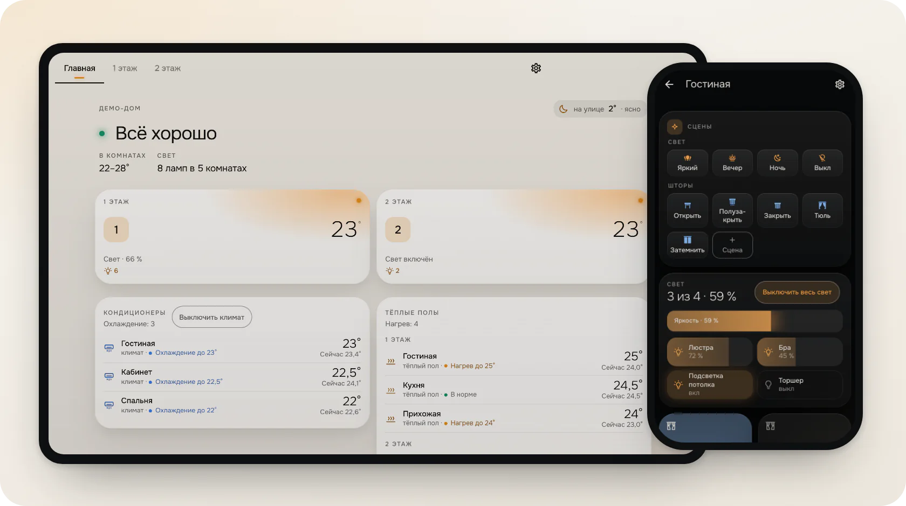
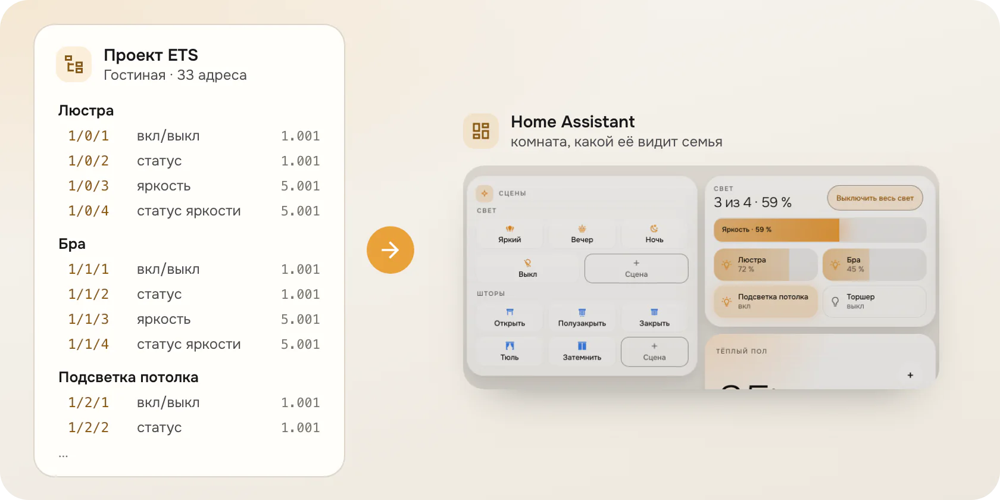
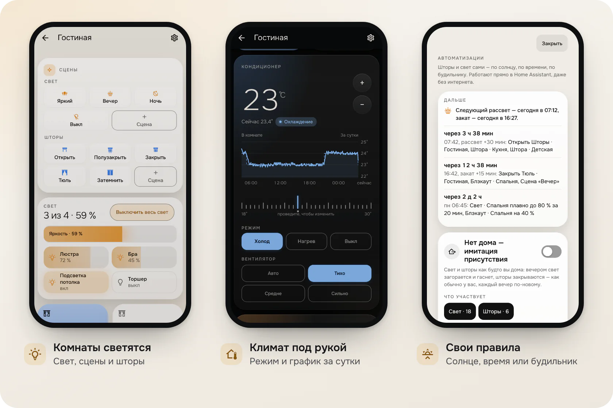

# Агент Hauflo

[English](https://github.com/Hauflo/hauflo-agent/blob/main/README.md) · **Русский**

**Проект ETS или готовый Home Assistant на входе, готовый объект на выходе: комнаты, устройства, панель заказчика и аварии. Начинаем с KNX, но начать можно и без него.**

Бесплатно во время беты; нужен аккаунт Hauflo ([запросить доступ](https://app.hauflo.ru/request-access)).

**Попробовать без установки:** [демо-дом](https://hauflo.ru/demo/) — настоящие карточки на выдуманном доме, прямо в браузере.

[](https://github.com/Hauflo/hauflo-agent#install) [](https://github.com/Hauflo/hauflo-agent#install) [](https://github.com/Hauflo/hauflo-agent/releases)

**Установка:** Настройки → **Marketplace** → **Добавить по ссылке** → `https://github.com/Hauflo/hauflo-agent` (Интеграция); на Home Assistant до 2026.11 — HACS → ⋮ → **Пользовательские репозитории**. [Подробные шаги](#установка).

[](https://my.home-assistant.io/redirect/hacs_repository/?owner=Hauflo&repository=hauflo-agent&category=integration)

## Проект на входе. Объект на выходе.

Агент связывает Home Assistant на объекте с [Hauflo](https://hauflo.ru), где KNX-интегратор планирует объект по проекту ETS.



1. **Загрузите** `.knxproj` или CSV групповых адресов ETS.
2. **Проверьте план.** Комнаты, устройства, сцены. Где адрес можно понять двумя способами, решаете вы.
3. **Примените.** Агент делает резервную копию, потом создаёт всё в Home Assistant.
4. **Сдайте объект.** Телефон и настенный планшет, светлая и тёмная тема.

Ни одной карточки вручную. Изменили проект ETS, загрузили заново — панель обновилась.

### Дом без KNX

Файла ETS нет или Home Assistant на объекте уже стоит? Создайте проект **«Есть Home Assistant»** и подключите дом кодом агента. Файл ETS — один из источников, его можно добавить в любой момент.

- **«Внедрение в этот Home Assistant»** (карточка на «Импорте»): что в доме уже есть, у каждого числа указан источник; заключение — **«Готово к внедрению»**, **«Готово к внедрению, есть замечания»** или **«Внедрение невозможно»**; и план: что Hauflo создаст, что оставит без изменений, о чём спросит. Только чтение.
- **«Импортировать из Home Assistant»:** этажи и области Home Assistant становятся этажами и комнатами проекта как есть, с предпросмотром и без изменений в Home Assistant.
- **Внедрение без KNX:** панель Atelier строится по комнатам Home Assistant; устройства других интеграций стоят на страницах комнат.
- **Что агент для этого читает:** реестры (сущности, устройства, области, этажи, интеграции), список панелей и версии Home Assistant и агента. **Чего не читает:** содержимое чужих автоматизаций, скриптов и панелей — только считает их.

## Для заказчика



- **Всё одним взглядом.** «Всё спокойно» — или что требует внимания.
- **Комнаты светятся**, когда в них что-то включено. Касание открывает комнату.
- **Климат** с графиком за сутки. Уставки нагрева и охлаждения, если термостат умеет оба. Тёплый пол показывает «нагревает» или «держит».
- **Шторы** — всей комнатой или по одной.
- **Свой вид панели.** Сцены в своих блоках или сверху, комнаты и климат крупно или компактно (компактно — строки, как в лучших панелях). Одно касание — и снова как настроил интегратор.
- **Настройки.** Светлая или тёмная тема у каждого своя. Зима или лето (или «Обогрев / Охлаждение» — как назовёт интегратор) сразу для выбранных интегратором термостатов; подсказка, когда по температуре на улице пора переключить.
- **Аварии**, которые звонят даже в беззвучном режиме, с кнопкой действия и **«Принять»**.
- **Телефон и настенный планшет** — с режимом киоска и затемнённым экраном ожидания. Русский и английский.

## Автоматизации, которые задаёт заказчик

В панели: **Настройки → Автоматизации**. Заказчик привязывает шторы и свет к рассвету, закату, времени или будильнику телефона (на Android читается напрямую, на iPhone — через автоматизацию в приложении «Команды», шаги на экране правила). Правило может сработать раньше или позже, до двух часов, в выбранные дни. Есть свет-будильник, который разгорается плавно, лента того, что будет дальше и больше двадцати готовых рецептов для этого дома (солнце, подъём, ночь, уход и приход, движение и двери, воздух по CO₂ и влажности). Агент предлагает только те, что подходят устройствам дома, с безопасными значениями, которые заказчик правит до сохранения.

Правила работают только со светом, шторами и сценами Hauflo. Замки, охрану, краны, гаражные двери и ворота они не изменяют никогда. Каждое правило — обычная автоматизация Home Assistant, поэтому работает без Hauflo и без интернета.

## Для вас, интегратора

- **План перед каждым применением.** Ничего не применяется, пока вы не подтвердите. Для удаления — отдельная отметка.
- **Резервная копия перед каждым изменением.** Нет резервной копии — нет применения.
- **Повторный импорт без потерь.** Комнаты, имена и сцены остаются. Повторное применение без изменений ничего не меняет.
- **Ни портов, ни токенов.** Одно исходящее шифрованное соединение. Никакого проброса портов.
- **Все объекты на одном экране.** Связь с каждым объектом, шина KNX, замолчавшие устройства, журнал событий.
- **Аварии — как вы настроили.** Каждое правило — обычная автоматизация Home Assistant: уведомление с «Принять» и повтором, пока кто-то не нажмёт; сверху Telegram. Почты нет.

## Установка

**Нужно:** Home Assistant 2026.9 или новее, аккаунт GitHub для [Marketplace](https://www.home-assistant.io/integrations/marketplace/) (встроен в Home Assistant с 2026.11; на более старых — [HACS](https://hacs.xyz)), исходящий HTTPS и KNX IP интерфейс или роутер, который поддерживает KNX-интеграция Home Assistant.

1. **Добавьте репозиторий.** Кнопкой ниже (она откроет Marketplace, на старом Home Assistant — HACS) или вручную:

   **Home Assistant 2026.11 и новее:** **Настройки → Marketplace**. При первом входе отметьте **Я понимаю риски и согласен** → **Продолжить**. Затем **Добавить по ссылке**, вставьте `https://github.com/Hauflo/hauflo-agent`, тип **Интеграция**. Home Assistant попросит **Подключить GitHub**: **Продолжить**, откройте ссылку и введите показанный код. Hauflo пока нет в каталоге Marketplace, поэтому для добавления по ссылке нужно это подключение; оно читает только публичные данные.

   **До 2026.11:** в HACS: ⋮ → **Пользовательские репозитории** (Custom repositories), вставьте `https://github.com/Hauflo/hauflo-agent`, тип **Интеграция**.

   [](https://my.home-assistant.io/redirect/hacs_repository/?owner=Hauflo&repository=hauflo-agent&category=integration)

2. Откройте **Hauflo** → **Установить** (в HACS — **Скачать**) и **перезапустите Home Assistant**.

   **GitHub не открывается** (бывает в РФ): в терминале Home Assistant (дополнение Terminal & SSH) выполните
   `wget -qO- https://app.hauflo.ru/agent/install.sh | sh` и перезапустите Home Assistant. Скрипт берёт тот же архив
   релиза из первого ответившего источника — GitHub, app.hauflo.ru, app.hauflo.com — и сверяет контрольную сумму
   с серверами Hauflo. Обновление — тот же запуск.
3. **Получите код** в Hauflo: проект → **Подключить объект** → **Получить код**. Он действует один раз, 30 минут.
4. **Добавьте интеграцию** и введите код. Сервер определится по коду: `RU-…` → app.hauflo.ru, `EU-…` → app.hauflo.com. **Дополнительно → Сервер Hauflo** нужен только для своего сервера — не меняйте. Если этот Home Assistant ещё подключён к объекту другого аккаунта Hauflo, появится отметка **Да, перенести этот Home Assistant в этот проект**. Без неё ничего не меняется.

   [](https://my.home-assistant.io/redirect/config_flow_start/?domain=hauflo)

   Ссылка работает только после перезапуска Home Assistant с установленным Hauflo и если «My Home Assistant» знает адрес вашего экземпляра (Настройки → My Home Assistant). Если пишет «неизвестная интеграция» или не открывается — вручную: Настройки → Устройства и службы → **Добавить интеграцию** → **Hauflo**.

5. **Подтвердите адреса KNX.** Уберите то, чем Hauflo управлять не должен, например ворота или замок.
6. Через несколько секунд в Hauflo появится **агент онлайн**. Откройте **Внедрение**, проверьте план, примените.

## Параметры

**Настройки → Устройства и службы → Hauflo → Настроить.** Сохраняются сразу, без перезапуска.

- **Разрешить Hauflo менять настройки этого объекта** (по умолчанию включено). Выключено — Hauflo ничего не меняет в Home Assistant: применения, панели, комнаты, KNX-сущности и резервные копии от Hauflo отклоняются. Мониторинг, аварии и голос работают.
- **Разрешённые адреса.** Групповые адреса KNX, на которые Hauflo может слать команды: `1/1/5`, диапазон `1/1/1-21` или вся средняя группа `1/1`, через запятую или с новой строки. Уберите то, чем Hauflo управлять не должен, например ворота или замок.
- **Разрешить запрошенные адреса.** Появляется, только когда Hauflo попросил адреса вне списка (об этом скажет и раздел «Ремонт»). Неотмеченные отклоняются при сохранении.
- **Сделать объект независимым от Hauflo.** отметка открывает отдельный шаг: что будет сделано, что перестанет работать, и только потом ваше подтверждение. См. [Уход с Hauflo](#уход-с-hauflo).

Подключить по новому коду (другой проект): **⋮ → Перенастроить**. Если объект отключили в Hauflo, Home Assistant сам попросит новый код (**Повторная аутентификация**).

## Сущности интеграции

Все — у одного служебного устройства **Hauflo**.

| Сущность | Что это | Когда |
| --- | --- | --- |
| `binary_sensor.hauflo_link` (**Связь**, диагностика) | Включена, пока агент на связи с Hauflo. Атрибут `server` — какой сервер Hauflo. | Всегда |
| `sensor.hauflo_made_in_this_home` (**Создано на этом объекте**, диагностика) | Сколько сущностей Hauflo создал или перенял здесь. Атрибуты: `by_kind`, `hand_edited` (переименованы или отключены в Home Assistant либо оставлены последним планом как правка человека), `next_deploy` (что следующое применение создаст, обновит, предложит убрать и когда Hauflo это сказал). Только просмотр. | Всегда |
| `binary_sensor.hauflo_daylight` (**На улице светло**) | Включён, пока на улице светло: по уличному датчику освещённости, который выбрал администратор, иначе по высоте солнца; смена держится 10 минут. Пока он включён, сцена Hauflo не включает свет, отмеченный заказчиком **«Днём не включать в сценах»** (ниша, полка). Атрибуты: `source`, `value`, `threshold`, `since`. | Всегда |
| **Рекомендуемый сезон** / **Текущий сезон** (сенсоры), **Переключать автоматически** (переключатель) | «Зима / Лето» (или «Обогрев / Охлаждение»): действующий режим, подсказка по уличной температуре и признак, что режим раз в день переключается сам. Переключатель меняет только обслуживающий, не заказчик. | После настройки «Зима / Лето» в Hauflo |
| **Правило · имя** (переключатель), **Сработало · имя** (бинарный сенсор) | Для каждого правила (по значению — например, вентиляция по CO₂, или по расписанию) — переключатель и датчик «сработало». | После применения с правилами |

**Метка «Hauflo».** На каждой сущности, которую Hauflo создал или перенял, — метка **Hauflo** (**Настройки → Пространства, метки и зоны → Метки** или фильтр по метке на странице сущностей). Агент ставит и снимает её сам и только на своём; метку, поставленную вручную на чужое, снимает. entity_id не меняются. Пока выключено **Разрешить Hauflo менять настройки этого объекта**, метка не изменяется. **Hauflo мониторинг** — другая метка: её ставите вы на устройства не из Hauflo, чтобы следить за ними.

Всё остальное, что создаёт применение (комнаты, KNX-сущности, группы света, сцены, панели), принадлежит собственным интеграциям Home Assistant, а не этой.

## Как обновляются данные

Без опроса. Агент держит одно исходящее WebSocket-соединение с Hauflo и сам переподключается с паузами. **Связь** меняется вместе с соединением. Раз в минуту агент отправляет Hauflo короткий статус (см. [Что уходит из дома](#что-уходит-из-дома)).

## Что уходит из дома

Hauflo может спросить только то, что есть в фиксированном списке агента, а часть ответов агент правит, прежде чем они уйдут. Точно:

**При применении, проверке устройств и мониторинге:**

- **Состояния сущностей любой интеграции, не только KNX:** entity_id, состояние, имя и фиксированный набор атрибутов (класс устройства, единица, температуры и уставки, режимы, яркость и цветовая температура, положения, варианты, мин / макс / шаг). Остальные атрибуты остаются дома.
- **Не уходят совсем:** сущности телефонов (все сущности `mobile_app`) — даже их entity_id, в которых имя телефона.
- **Скрыто:** люди, трекеры, зоны, камеры, изображения, медиаплееры, календари, списки дел, погода, солнце, замки, охранные панели, notify / TTS / STT / диалог, а также датчики движения, присутствия, дверей, окон и гаражных ворот (если их не сделал Hauflo и вы не дали им метку **Hauflo мониторинг**). У них уходят только имя, класс устройства, иконка и поддерживаемые функции; состояние — `hidden`, время удаляется.
- **Список реестра сущностей** (entity_id, имена, интеграции, unique_id, комнаты, метки; без сущностей телефонов) и **список реестра устройств** (имена, модели, производители, комнаты; у телефонов имя, модель и производитель удаляются).
- **Для настройки аварий** (кому приходят аварии): люди этого Home Assistant и телефоны с приложением Home Assistant — имя, ОС и владелец, — чтобы выбрать получателей в Hauflo.
- Комнаты, этажи и метки. Названия всех панелей и содержимое панелей Hauflo (никогда — других панелей заказчика). Какие сущности открыты голосовым ассистентам.
- Версия Home Assistant, часовой пояс, язык, система единиц, валюта, список загруженных интеграций и внешний адрес без логина. Включено ли Home Assistant Cloud, Alexa и Google — без аккаунта. Не координаты и не название дома.
- KNX: проект ETS, загруженный в интеграцию KNX Home Assistant, настройки KNX-сущностей и какие групповые адреса слали телеграммы (адреса и время, никогда — значения).
- Мост HomeKit, который настроил Hauflo, — его код сопряжения и QR: Hauflo показывает их вам, чтобы добавить мост в Apple Home (не сохраняются). Алиса — её настройки метки.

**Раз в минуту:** версии Home Assistant и агента, связь с KNX, сколько KNX-сущностей недоступно (до 10 entity_id), имя и состояние сущностей с меткой **Hauflo мониторинг**, открытые аварии и выключен ли переключатель владельца. Для паспорта обслуживания в пакете сдачи: как подключён KNX (туннель или маршрутизация, адрес и порт шлюза, физический адрес; включён ли KNX Secure — никогда его ключи и пароли), адрес Home Assistant и имена его администраторов (без паролей).

**Новое в 0.34 по запросу** (тот же фиксированный список, то же одно исходящее соединение): проверки пусконаладки после применения (шина, сцены, группы, автоматизации, панель, голос) читают только состояния и реестр; «читать после команды» и опрос для устройств без обратной связи; **Что открыто голосовым помощникам** и **Закрыть опасное** меняют только то, какие сущности открыты голосу; «+ Свой сигнал» делает сигналом аварии любую сущность объекта; парк обновляет агент волнами с откатом на прежнюю версию.

**Раз в минуту, ещё (0.34):**

- **Один счётчик аварий:** открытые сейчас аварии с именем датчика, классом и временем начала — агент считает их один раз, это число показывают мониторинг Hauflo, карточки, парк и Telegram-бот.
- **Наблюдения по собственной норме объекта** («Фоновые наблюдения» и «Привычки» в **Анализе**): зона или датчик заметно вне выученной нормы — имя сущности, замечание и его числа, никогда не действие — и ваши выборы **Это норма** / **Снова следить** на карточке в Home Assistant.
- **Другие интеграции под присмотром агента:** какие он перезапустил, не смог вернуть или увидел снова в работе.
- **Сигналы аварий:** выборы **Авария когда** на строке карточки в Home Assistant и хеш политики сигналов, которую держит агент.
- **Интеграции, которые Hauflo здесь ставит,** с шагами каждой; часовой пояс, выключен ли переключатель владельца, какие функции есть в этой версии агента и известны ли уже его правила аварий.

**Гостевой доступ:** пока гость пользуется ссылкой, состояния света, штор и климата комнат из этой ссылки идут через Hauflo в браузер гостя, а IP-адрес гостя доходит до сервера Hauflo, как у любого посетителя. Кто гость, не записывается; журнал гостей остаётся в Home Assistant.

**Никогда:** где находятся люди, изображения и токены камер, медиа, календари, PIN-коды (кроме кода сопряжения HomeKit выше), пароли, ключи KNX Secure, резервные копии, база истории.

**Где хранятся данные.** Российские аккаунты — app.hauflo.ru, в России. Европейские — app.hauflo.com, в ЕС. Исключение при передаче: у российского региона нет прямого доступа к Telegram, поэтому текст уведомления в Telegram и идентификатор чата получателя проходят транзитом через сервер Hauflo и далее в Telegram (не сохраняются и не пишутся в журнал). Европейский регион отправляет их в Telegram напрямую.

## Безопасность простыми словами

- **Одно исходящее шифрованное соединение.** В домашней сети ничего не слушает порты. У Hauflo нет токена Home Assistant: агент — отдельный системный пользователь, он удаляется вместе с интеграцией.
- **Точный список того, что Hauflo может,** проверяется внутри этого Home Assistant. Команды KNX — только на адреса, которые вы подтвердили.
- **Выключатель владельца.** В параметрах интеграции: **Разрешить Hauflo менять настройки этого объекта**. Выключен — Hauflo ничего не меняет. Мониторинг, аварии и голос работают.
- **Резервная копия перед изменениями.** Применить без резервной копии можно только явным выбором, тогда в HA остаётся уведомление. Восстановить: **Настройки → Система → Резервные копии**, с Hauflo или без.
- **Открыто для чтения.** Исходный код лежит здесь — можно проверить, что работает в доме.

<details>
<summary><b>Полный список: можно и нельзя</b></summary>

**Hauflo может через агента:**

- создавать комнаты, этажи и метки, KNX-устройства проекта;
- создавать и обновлять свои панели и сцены, ставить свою панель и тему по умолчанию;
- записывать свои правила (`hauflo_auto_*`) в `automations.yaml` — чужие автоматизации не изменяет, файл, оформленный вручную, не переписывает;
- задавать место дома и часовой пояс в Home Assistant — только администратор, со страницы **Автоматизации** заказчика;
- скрывать неиспользуемые пункты бокового меню Home Assistant (Карта, Энергия, Журнал…) у пользователей (у всех, кроме администраторов Home Assistant — у них меню полное, если не включено **Также у администраторов**) — опция **Убрать неиспользуемое из меню**;
- копировать файлы своих карточек в `/config/www/hauflo`;
- настраивать подключение KNX к интерфейсу в доме, группы света, голосовой доступ и мост Apple Home;
- задавать комнату, имя и блок панели (метка `hauflo_role_*`) устройствам и сущностям других интеграций — только так, как выбрал интегратор в **«Настроить»**, и только в плане изменений. То, что открывает дом (замки, охранные панели, краны, ворота, гаражные двери), шина KNX и телефоны в комнаты и блоки не ставятся никогда. Первое значение сохраняется, **«Откатить»** возвращает его (что вы потом изменили сами, остаётся);
- читать состояния для мониторинга и аварий;
- отправлять команды KNX только в диапазоны групповых адресов, которые вы подтвердили.

**Не может:**

- скачивать резервные копии, трогать дополнения, чужие автоматизации и произвольные службы;
- удалять устройства и сущности, которые создал не он, и менять их сверх комнаты, имени и блока выше (сделанное вручную остаётся вашим);
- читать ключи и пароли KNX Secure;
- отдавать замок, охранную панель или кран голосовому ассистенту, группе или сцене.

**Резервная копия** — настройки без базы истории; зашифрована, если в Home Assistant задан ключ резервных копий. Без свежей резервной копии агент ничего не меняет — если только интегратор явно не выбрал применение без неё; тогда в HA остаётся уведомление.

**Что уходит из дома** — точно в [отдельном разделе](#что-уходит-из-дома).

</details>

<details>
<summary><b>Аварии</b></summary>

Настраиваются в Hauflo → **Аварии**. Правило: что случилось → какие датчики → кому → как.

- **Уведомления на телефоны заказчика** через приложение Home Assistant. Критичные звонят даже в беззвучном режиме (Critical Alerts на iOS, поток будильника на Android). Повторяются, пока кто-то не нажмёт **«Принять»**; «снова в норме» снимает уведомление. Кнопка действия делает очевидное, например «Перекрыть воду».
- **Telegram** через [@hauflo_bot](https://t.me/hauflo_bot) — вам, дежурному инженеру или клиенту. Каждый получает аварии только своих объектов.
- Каждое правило — автоматизация в этом Home Assistant с переключателем «Принято», с именем «Авария: <правило>» (её код в `automations.yaml` — `hauflo_alarm_…`; имя сущности Home Assistant строит из названия, например `automation.avariia_…`, и не переименовывает). Она работает без Hauflo и без агента, в том числе без интернета, и остаётся после удаления интеграции. Правило, которое Home Assistant не может принять (файл `automations.yaml` оформлен вручную, изменения закрыты владельцем), остаётся у агента — об этом будет сказано. Автоматизацию, изменённую вручную, Hauflo не перезаписывает.
- Автоматизация простая — её можно читать в визуальном редакторе: три триггера (авария держится выдержку правила, все датчики снова в норме, «Принять» из уведомления) и два действия (уведомление / «снова в норме» / «Принято», затем повтор, пока авария открыта: первые 12 раз с шагом правила, дальше раз в час, чтобы за ночь не исчерпать дневной лимит уведомлений телефона). Второй помощник «Hauflo · авария открыта: …» (`input_boolean.hauflo_open_…`) помнит открытую аварию. Дребезжащий датчик и «нет связи» сообщает агент: Home Assistant сообщает каждую аварию, которая продержалась после возврата в норму дольше окна правила; повтор и кнопка ждут в запуске автоматизации, перезапуск Home Assistant их прерывает (следующая авария запускает снова).
- **Важность сигналов** (по ISA-18.2, блок «Важность» на странице «Аварии»; менять — интегратор объекта и владелец / администратор компании): протечка, дым, газ, CO, KNX и потеря связи — сразу; остальные правила и события — важно (повтор не чаще раза в час); короткие обрывы связи и подсказки — в сводку. «Выкл.» выключает класс.
- **Сводка раз в сутки** в 08:00 по времени объекта, одним сообщением до 12 пунктов, в личные чаты Telegram и в группы. **Тихие часы** 23:00–08:00 откладывают «важно» до сводки; критичные аварии приходят всегда сразу. Датчик, сработавший 3 раза за сутки, на сутки уходит в сводку.
- **Группа Telegram:** добавьте бота в группу сами — если ваш личный чат с ботом уже подключён, группа сразу подключится к аккаунту (ссылка в приложении тоже работает); темы форума — как прежде.
- Аварии идут только пушем и в Telegram; почта не канал аварий.

Чтобы следить за любой другой сущностью (авария котла, вентиляция, батарейка), повесьте на неё метку **Hauflo мониторинг** в Home Assistant.

</details>

<details>
<summary><b>Голос</b></summary>

- **Фразы Assist для тёплого пола и термостатов.** У KNX-тёплого пола часто нет объекта вкл/выкл, и на «выключи тёплый пол» Home Assistant отвечает ошибкой. Агент добавляет свои фразы: выключает, где термостат умеет, а иначе объясняет, что держит уставку. «Сделай в спальне 22» и «сколько в спальне» идут к термостату этой комнаты.
- **Apple Home и Алиса.** Внедрение может настроить мост Apple Home (QR-код для подключения — на странице сдачи объекта) и открыть комнаты Алисе. Замки, охранные панели и краны не открываются никогда.

</details>

<details>
<summary><b>Агент сам отправляет команды в шину KNX?</b></summary>

Нет. Команда уходит в шину, когда действует человек: касание на панели, сцена, голос, кнопка действия в аварии, переключатель «Зима/Лето» или правило, которое задал заказчик в **Автоматизациях**.

Два исключения. Первое — **повтор «Зима/Лето»**. KNX-термостат может потерять режим после пропадания питания шины или сброса, поэтому агент повторяет выбранный заказчиком режим — по умолчанию раз в час (интегратор меняет интервал или выключает), после запуска Home Assistant и когда связь с KNX вернулась. Термостат он не включает; общий адрес переключения отправляется один раз. Подсказка по температуре на улице только спрашивает заказчика и сама ничего не переключает.

Второе — когда заказчик его включил: **Нет дома — имитация присутствия**. Свет — только вечером в темноте, шторы — в обычное время; только светильники и шторы Hauflo. Выключили — гасит свет, который зажгла сама.

</details>

<details>
<summary><b>Что будет, если Hauflo или интернет недоступны?</b></summary>

Дом работает. Это обычный Home Assistant со стандартными KNX-устройствами. Панель, автоматизации, уведомления об авариях и переключатель «Зима/Лето» работают внутри Home Assistant. Hauflo покажет объект офлайн, агент переподключится сам.

</details>

<details>
<summary><b>Hauflo перезапишет то, что я сделал вручную?</b></summary>

Нет. Hauflo помнит, что создал сам, и меняет только это. Единственное исключение — устройства других интеграций, которые интегратор настроил в **«Настроить»** (комната, имя, блок): это снимает **«Откатить»**. Ваши сущности, автоматизации и панели остаются как есть. Если вы поправили то, что сделал Hauflo, он это заметит и сохранит вашу правку.

</details>

<details>
<summary><b>Как разрешить ещё адреса KNX?</b></summary>

**Настройки → Устройства и службы → Hauflo → Настроить.** Если Hauflo нужен ещё не разрешённый адрес, он ждёт там вашего подтверждения.

</details>

<details>
<summary><b>«Код неверный или истёк»</b></summary>

Код действует один раз, 30 минут. Получите новый в Hauflo: проект → **Подключить объект** → **Получить код**. Если Home Assistant вообще не достучался до Hauflo, проверьте у него доступ в интернет.

</details>

<details>
<summary><b>«Нажимаю в HA — актор молчит»</b></summary>

Откройте монитор групповых адресов (**Настройки → Устройства и службы → KNX → Монитор**) и нажмите ещё раз. Телеграммы нет: адрес вне разрешённых диапазонов агента (**Настройки → Устройства и службы → Hauflo → Настроить**) или туннель занят (ETS, визуализация). Телеграмма уходит, а актор молчит: у его объекта в ETS нужны флаги **W** (и **T** для статуса), устройство должно быть запрограммировано.

</details>

<details>
<summary><b>«Мой Home Assistant старше 2026.9»</b></summary>

Версию показывает **Настройки → О программе**; обновить — **Настройки → Система → Обновления** (сначала резервную копию). Агенту нужен 2026.9 или новее.

</details>

<details>
<summary><b>«Что меняется в панели при обновлении агента?»</b></summary>

После обновления (Настройки → Обновления) и перезапуска карточки и тема Hauflo обновляются сами, ваши ручные правки панели сохраняются. Если карточки выглядят по-старому — обновите страницу (Ctrl+F5) или приложение HA.

</details>

## Примеры

Узнать, что дом надолго потерял связь с Hauflo (дом работает; мониторинг и применения ждут):

```yaml
automation:
  - alias: "Нет связи с Hauflo"
    triggers:
      - trigger: state
        entity_id: binary_sensor.hauflo_link
        to: "off"
        for: "00:30:00"
    actions:
      - action: persistent_notification.create
        data:
          title: "Hauflo"
          message: "Нет связи с Hauflo 30 минут."
```

Зима или лето выбираются в панели («Настройки») или в Hauflo, а не сущностью, которую можно переключить: `sensor.hauflo_season_current` показывает действующий режим, `sensor.hauflo_season_recommended` — подсказку, на любую из них можно повесить свою автоматизацию.

## Известные ограничения

- **Нужен аккаунт Hauflo.** Без него интеграцию не настроить.
- **Один агент на Home Assistant.** Один Home Assistant — один проект Hauflo.
- **Импорт файла проекта — только KNX** (`.knxproj` или CSV из ETS). В доме без KNX комнаты берутся из областей Home Assistant (**«Импортировать из Home Assistant»**). Устройства других интеграций из файла не импортируются: их ставят на панель, а **«Настроить»** задаёт комнаты, имена и блоки.
- **Home Assistant 2026.9 или новее.** Агент читает части интеграции KNX Home Assistant, которые не являются публичным API. Если новый Home Assistant их изменит, агент выключит только эти функции и скажет какие в разделе **Ремонт**.
- **`automations.yaml` / `scenes.yaml`, оформленные вручную** (комментарии, `!include`, `!secret`), никогда не переписываются — собственные автоматизации и сцены заказчика туда не сохранятся, пока файл не станет обычным.
- **Ресурсы панелей в режиме YAML** агент добавить не может. При удалении (или «Сделать объект независимым») карточки копируются в `/config/www/hauflo`, а Home Assistant показывает уведомление с двумя строками, которые нужно дописать в `configuration.yaml`.
- **Голосовые фразы для тёплого пола** пока только на русском.
- **Тема Hauflo Atelier** живёт в памяти и уходит вместе с агентом; панели сохраняют карточки и выглядят как Home Assistant.

## Обновление и удаление

**Обновление** — в **Настройки → Обновления**, когда Hauflo покажет новую версию (Marketplace проверяет добавленный по ссылке репозиторий раз в 48 часов; проверить сейчас: Marketplace → Hauflo → ⋮ → **Обновить информацию**; на старом Home Assistant — HACS), затем перезапуск Home Assistant. Что изменилось — в [релизах](https://github.com/Hauflo/hauflo-agent/releases).

**Удаление** — **Настройки → Устройства и службы → Hauflo → Удалить**, затем в Marketplace (Hauflo → **Удалить**; Home Assistant может сам предложить это при удалении интеграции; на старом Home Assistant — HACS). В Hauflo проект покажет «агент офлайн» — отключите его там или подключите заново позже.

**Вместе с агентом уходят:** его системный пользователь, голосовые фразы (`custom_sentences/ru/hauflo.yaml`), правила аварий и настройки «Зима/Лето», гостевые ссылки и журнал гостей, кто обслуживает объект, и история доступа (`.storage/hauflo.service`), последний план на «Создано на этом объекте»; скрытые пункты меню возвращаются всем. Свет, который зажгла «Нет дома», гаснет. Автоматизации аварий `hauflo_alarm_…`, которые записало применение (агент 0.26+), остаются и работают без агента; служба `hauflo.remove_alarms` (администратор Home Assistant) их убирает, см. ниже. Аварии старого агента уходят вместе с ним, если сначала не выполнить «Сделать объект независимым».

**Панель заказчика продолжает работать** (проверено на чистом Home Assistant: удаление, удаление файлов интеграции, перезапуск). При удалении карточки, иконки и шрифт копируются в `/config/www/hauflo` и подключаются ресурсами панелей `/local/hauflo/hauflo-icons.js` и `/local/hauflo/hauflo-cards.js`. Уходит только тема Hauflo Atelier — карточки выглядят как обычный Home Assistant. В режиме ресурсов YAML Home Assistant покажет, что дописать.

**Остаётся — намеренно.** Панель клиента должна работать дальше, а агент, добавленный снова, — найти своё, а не делать дубли. Уберите вручную только то, что больше не нужно:

| Что остаётся | Зачем | Как убрать вручную |
| --- | --- | --- |
| Панели `hauflo-…` | Панель заказчика | **Настройки → Панели** → панель → **Удалить** |
| Панель Hauflo как панель по умолчанию | Заказчик открывает свою панель | **Настройки → Панели**: сделайте панелью по умолчанию другую |
| `/config/www/hauflo` и ресурсы Lovelace `/local/hauflo/hauflo-icons.js`, `/local/hauflo/hauflo-cards.js` | Карточки этой панели | После удаления панелей: **Настройки → Панели → ⋮ → Ресурсы** (расширенный режим) → удалить оба, затем удалить папку |
| Автоматизации `hauflo_auto_…` | Правила заказчика — обычные автоматизации HA | **Настройки → Автоматизации и сцены** → удалить |
| Сцены `hauflo_…` и `hauflo_fam_…` | Обычные сцены HA | **Настройки → Автоматизации и сцены → Сцены** → удалить |
| `automations.yaml.hauflo-bak-*`, `scenes.yaml.hauflo-bak-*` (по 3 последних) | Копии перед каждой записью | Удалить файлы в `/config` |
| Метки **Hauflo** и **Hauflo мониторинг** (и метки категорий и `hauflo_role_*` от применения) | Метки на ваших сущностях: **Hauflo** по-прежнему показывает, что сделал Hauflo | **Настройки → Пространства, метки и зоны → Метки** |
| Автоматизации `hauflo_independent_…` (если дом сделан независимым) | Ваши аварии, теперь обычные автоматизации HA | **Настройки → Автоматизации и сцены** |
| Автоматизации `hauflo_alarm_…` и помощники `input_boolean.hauflo_ack_…` («Hauflo · принято: …»), `input_boolean.hauflo_open_…` («Hauflo · авария открыта: …») | Аварии приходят на телефоны и без Hauflo; Home Assistant показывает об этом уведомление | До удаления: **Панель разработчика → Действия → `hauflo.remove_alarms`** (администратор). После: **Настройки → Автоматизации и сцены** и **Настройки → Устройства и службы → Помощники** |
| `/config/.storage/hauflo.*` (что сделал Hauflo, названия, порядок, сцены, автоматизации, «Нет дома», сезон, открытые аварии) | Агент, добавленный снова, продолжит с того же места | Остановите Home Assistant, удалите `/config/.storage/hauflo.*`, запустите |
| Комнаты, этажи, KNX-сущности, группы света, мост HomeKit, доступ голосовым ассистентам | Это сам дом | Как любые элементы Home Assistant, в **Настройках** |
| Резервные копии, сделанные Hauflo | Ваша страховка | **Настройки → Система → Резервные копии** |

### Уход с Hauflo

**Настройки → Устройства и службы → Hauflo → Настроить → Сделать объект независимым от Hauflo.** Сначала спросит, затем:

- оставит карточки панели в `/config/www/hauflo` ресурсами панелей насовсем — и при установленном агенте (обновляются при каждом запуске), так что панель не зависит от агента, как бы его ни удалили;
- приведёт каждое включённое правило аварии к актуальному виду — обычной автоматизации `hauflo_alarm_…` в `automations.yaml`: те же датчики и состояния аварии, уведомление на те же телефоны с приложением Home Assistant (критичный, если правило критичное), переключатель «Принято» и кнопка правила (например, «Перекрыть воду»). Перед записью делается копия `automations.yaml`. Файл, оформленный вручную, не изменяется — об этом будет сказано;
- ничего не удаляет.

**Что перестанет работать после удаления Hauflo:** облачный мониторинг («агент не на связи», «шина KNX молчит», страница мониторинга), аварии в Telegram, история аварий в Hauflo, применения и обновления из проекта, гостевые ссылки, имитация присутствия «Нет дома», повтор и подсказка «Зима/Лето», голосовые фразы, правка автоматизаций и сцен заказчика с панели (уже сделанные продолжают работать). Телефоны в автоматизациях — те, что были в приложении на тот момент: новый телефон добавьте в них вручную.

## Поддержка

- Почта: [support@hauflo.ru](mailto:support@hauflo.ru) (Россия) · [support@hauflo.com](mailto:support@hauflo.com) (EU)
- Telegram: [@hauflo_bot](https://t.me/hauflo_bot)
- Ошибки агента: [GitHub issues](https://github.com/Hauflo/hauflo-agent/issues). Приложите диагностику (Hauflo → ⋮ → **Скачать диагностику**; секреты и личные данные — имена контактов, телефоны, почта, названия проектов — из неё убраны).
- Сайт: [hauflo.ru](https://hauflo.ru) · [hauflo.com](https://hauflo.com)

## Лицензия

Исходный код опубликован, чтобы вы могли проверить, что работает в доме. Это не open source: устанавливать и запускать агента можно только с сервисом Hauflo, копировать в другие продукты нельзя. См. [LICENSE](https://github.com/Hauflo/hauflo-agent/blob/main/LICENSE).

<sub>Скриншоты: настоящие карточки Hauflo в демо-доме с симулированными состояниями.</sub>
